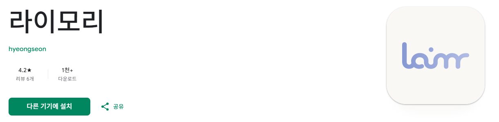
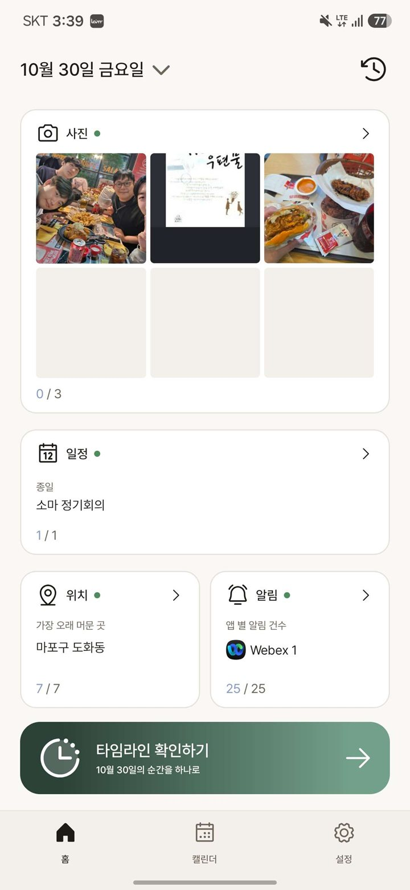
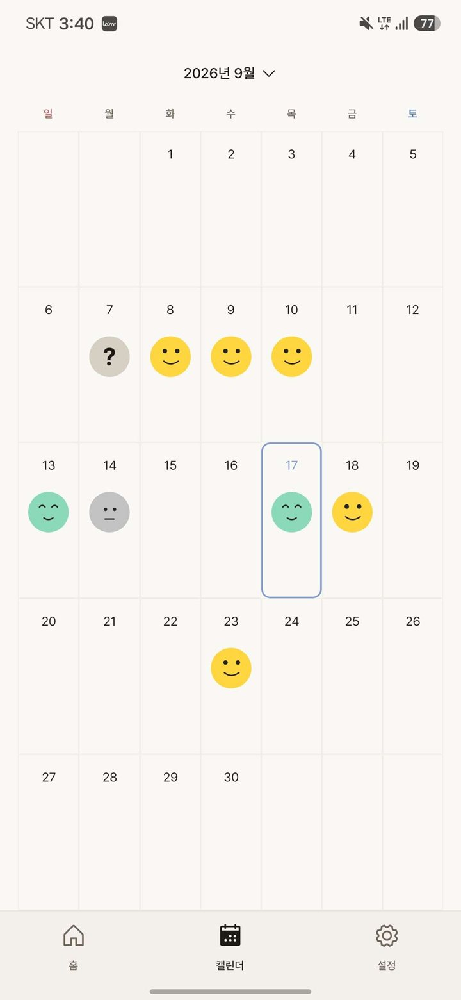
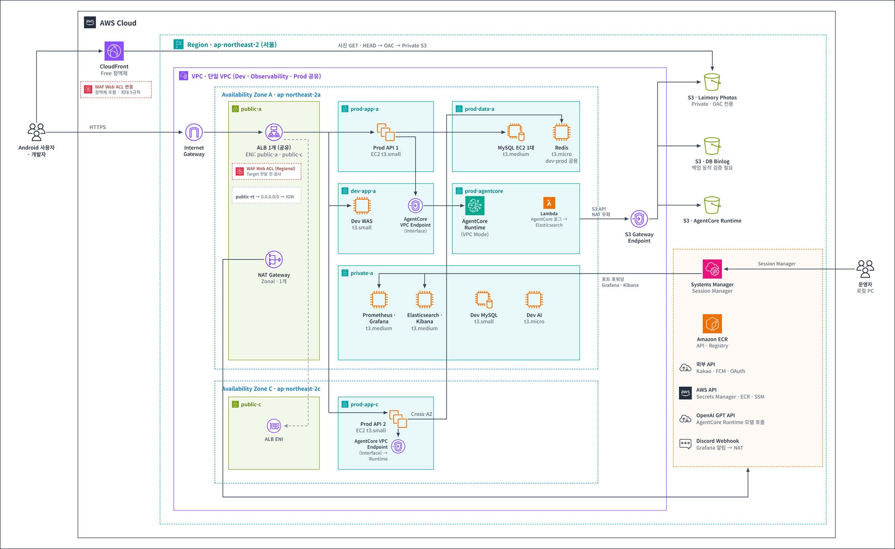

# Laimory Server

> 이미 폰 안에 있는 내 하루. 라이모리가 모아서 보여드릴게요.

AI·SW 마에스트로 17기 369팀 **라이모리(Laimory)** 의 백엔드 서버 저장소입니다.

[](https://play.google.com/store/apps/details?id=com.soma369.laimory&hl=ko)

## 프로젝트 소개

라이모리는 사용자의 모바일 기기 속 정보(위치, 사진, 캘린더, 알림)를 모아 AI가 정리해
**타임라인 형식의 일기**로 만들어 주는 Android 애플리케이션입니다.

일기 쓰기에는 장점이 많지만, 계속 쓰기에는 인지적·시간적 비용이 큽니다.
"오늘 뭐 했지?"에 답하려고 정보를 모으는 비용, 그리고 모은 정보를 정리해 기록하는 비용입니다.
라이모리는 이 두 비용을 AI가 대신 줄여 주는 것을 목표로 합니다.

| 홈 | 타임라인 | 캘린더 |
|:---:|:---:|:---:|
|  |  |  |
| 수집된 정보를 확인하고 선택하거나 제외할 수 있습니다. | AI가 정보들의 맥락을 파악해 이벤트로 묶어 줍니다. 수정과 메모 입력이 가능합니다. | 지난 기록을 캘린더로 볼 수 있습니다. |

## 프로젝트 구조

### 인프라 구조



제한된 비용 안에서 API 서버의 가용성을 먼저 확보하고, 단일 서버로 둔 데이터 계층은 백업과 경보로 보완하는 방향으로 설계했습니다.

- **API 서버 이중화**: API 서버 2대를 서로 다른 가용 영역(AZ)에 배치하고, 롤링 배포로 무중단 배포합니다.
- **데이터 계층**: MySQL과 Redis는 비용 때문에 단일 서버로 운영하고, MySQL은 백업과 경보 체계로 빠르게 복구할 수 있게 했습니다.
- **사진**: 앱이 presigned URL로 S3에 직접 업로드하고 CloudFront로 제공해 API 서버의 부담을 줄였습니다.
- **AI와 비밀값**: AI 서버는 Bedrock AgentCore로 호출하고, 비식별화에 쓰는 HMAC 키는 Secrets Manager에서 관리합니다.
- **운영 도구**: 로그·모니터링 서버는 공인 IP 없이 사설 서브넷에서 운영하고, SSM 포트 포워딩으로만 접속합니다.
- **CI/CD**: GitHub Actions가 OIDC로 AWS 권한을 받아 이미지를 ECR에 올리고, SSM으로 환경별 서버에 배포합니다.

### 코드 구조

기능별 패키지 안에 controller / service / repository 같은 계층 패키지를 두는 구조입니다.

```text
src/main/java/com/laimory/server
├── timeline      # 타임라인 초안 생성, 이벤트·아이템 저장, 사진 업로드
├── agentcore     # AI 서버(Bedrock AgentCore) 호출
├── geo           # 좌표 → 주소·건물명 보강
├── auth          # Google·Kakao 로그인, JWT 발급·검증
├── user          # 사용자 계정, 콘텐츠 subject 매핑(비식별화)
├── push          # FCM 푸시 알림
├── initializer   # 앱 시작 시 초기 데이터 조회
├── onboarding    # 온보딩 상태
├── terms         # 약관과 동의 이력
├── notice        # 공지
├── inquiry       # 문의
├── credit        # 크레딧
├── appconfig     # 앱 인트로 설정
├── admin         # 관리자 API
├── common        # 응답 포맷, 에러 코드, 로깅, Redis 접근, 개인정보 마스킹
└── config        # Security, OpenAPI, 비동기, 스케줄링, 캐시 설정

src/main/resources/db/migration   # Flyway 마이그레이션
deploy/                            # 모니터링·로그 서버 구성
.github/workflows/                 # CI, 배포
```

## 기술 스택

| 구분 | 기술 |
|---|---|
| 백엔드 | Java 21, Spring Boot 3.5, MySQL 8, Redis 7, Flyway |
| 인프라·배포 | AWS (EC2, ALB, S3, CloudFront, ECR, SSM, Secrets Manager, Bedrock AgentCore), Docker, GitHub Actions |
| 로그·모니터링 | Filebeat, Elasticsearch, Kibana, Grafana, Prometheus, Tempo |

## 개발 기간

- **기간**: 2026.05 ~ 현재
- **인원**: 3인 (Android, 백엔드, AI)
